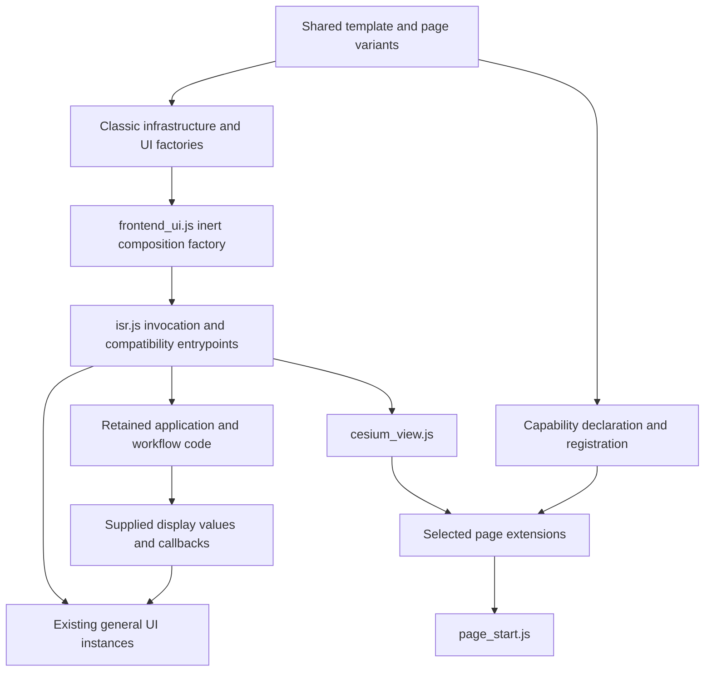

# Remaining frontend architecture plan

Status: **stages A–E complete; closed for this iteration**, 2026-10-26.
The [architecture closeout](FRONTEND_ARCHITECTURE_CLOSEOUT.md) evaluates the selected
goals, source scope, retained work and verification limits. Construction contracts
are in [General UI Composition](FRONTEND_UI_COMPOSITION.md); listener ownership
is in [General UI Lifecycle](FRONTEND_UI_LIFECYCLE.md); supplied-value/callback
contracts are in [Presentation Adapters](FRONTEND_PRESENTATION_ADAPTERS.md).
The earlier [small-extraction pass](FRONTEND_EXTRACTION_CLOSEOUT.md) stays closed.
This plan remains the implemented-boundary inventory and stage history, not an
active queue of additional refactoring. Domain calculations and operational
workflows remain outside the selected general UI scope.

## Purpose and decisions

Make dependencies, state ownership and startup visible enough that future changes
can be reviewed and tested as cohesive units. Reduce coupling before pursuing
further file-size reduction. Keep stable, tightly coupled code in place while its
ownership remains unclear.

Decisions for this workstream:

- Preserve classic-script/static hosting and shared page generation. A bundler,
  framework, ES-module conversion, directory migration and visual redesign are
  separate decisions, with no prerequisite status here.
- Keep existing state identities and compatibility entrypoints. Do not distribute
  copies of `state`, create a replacement global store, or move mutable objects
  solely to make `isr.js` shorter.
- Keep existing initialization timing and async behavior. A composition factory
  must not become a new startup owner incidentally.
- New general UI modules receive narrow adapters and supplied display values;
  avoid handing them the whole application state or an unrestricted service bag.
- Distinguish present behavior, proposed contracts and implementation evidence.
  Implemented boundaries are identified explicitly; future interface changes remain proposals.

This is the current frontend continuation of the older
[Modular Architecture proposal](MODULAR_ARCHITECTURE.md). That proposal contains
historical metrics and a broader directory/backend redesign. Its frontend tree,
size estimates and claimed gains are not this plan's implementation requirements.
Backend work and Phase 6 deferrals retain their existing scope.

## Observed responsibility map

Initial source inventory: repository revision `c58b7f3` (2026-10-24).
The stages A/B construction change is recorded below and in its contract. Symbol names are navigation anchors
for code review, not promises that their surrounding source can be moved together.
The primary location below records current ownership; it does not imply that
shared objects have a single writer today.

| Responsibility | Current primary location / symbols | Dependency boundary and disposition |
| --- | --- | --- |
| Generic DOM, preferences, HTTP, tabs and modal controls | Existing `dom_helpers`, `preferences`, `http_client`, `tab_controls`, `modal_control` modules | Retain documented contracts; independently testable infrastructure |
| General UI views/controllers | `debug_output`, `voice_controls`, `trace_view`, `chat_view`, `fleet_drawers`, `memory_view`, `llm_settings`, `view_preferences` | Retain; factories are inert and application adapters compose them |
| UI construction and compatibility adapters | `frontend_ui.js` constructs the seven adjacent general UI components; `isr.js` retains lexical bindings/adapters, viewport and `LLMSettings` composition | Stages A/B implemented for the adjacent group only; timing-sensitive locations remain |
| Page declarations/extensions | Shared template, variant manifest, `page_capabilities.js`, `page_start.js` | Already explicit; preserve weather preview/diagnostic selection and script order |
| Startup/listener coordination | Main `window.load` callback; two DOM-ready branches; `attach*` functions | Multiple owners/timing phases; inventory before consolidating any startup |
| General memory/trace integration | `attachMemoryHandlers`, `loadAgentMemories`, memory actions, `attachTraceHandlers` and trace writers | Mixed read/write/action integration retained; supplied-record views are already separate |
| Viewport and map integration | `viewState`, `mapState`, initialization helpers, Leaflet functions, `cesium_view.js` | Preference persistence is separate; map calculations and interaction remain unchanged |
| Broad application data | `state` and functions reading/writing its fields | Shared mutable object, not a general UI view model; keep current identity |
| Workflow state and permissions | `missionState`, `MissionMode`, permission and transition functions | Retain as an opaque legacy boundary in this plan |
| Segment-related state | `mission`, `segmentStore`, `missionReplay`, `segmentedImport` | Existing cooperating objects/compatibility surfaces; do not merge or delete based on names |
| Configuration, editing, drawing and statistics | Main-script configuration, input, canvas and display functions | Mixed state/calculation/presentation; no extraction selected here |
| Request/workflow integration | Main-script actions, `CompareUI`, `GnnUI` | Mixes payloads, results, state and presentation; retained outside general UI restructuring |
| Playback and domain calculations | Existing main-script functions and their consumers | Outside this workstream; no implementation migration proposed |

The inventory reads existing code; it is not a design for operational subsystems.

## State ownership and mutation rules

| State family | Current authority / lifetime | Rule for the planned general UI boundary |
| --- | --- | --- |
| DOM and controller-local listeners | The owning extracted controller; page lifetime unless explicitly disposed | Keep one controller instance per owned surface; remove only owned listeners |
| Settings selections/controller fields | `LLMSettings` and its preference adapter | Preserve method/field contracts, storage keys and startup; do not create another controller |
| Viewport saved record / duplicate key | `viewPreferences`; duplicate key belongs to one factory instance | Preserve current silent failure and duplicate-suppression semantics; no second store |
| Trace runs / memory response data | Existing application writers / server responses | Views receive supplied records; rendering does not acquire mutation or transport authority |
| Viewport and map engine state | `viewState`, `mapState`, existing engine integration | UI construction does not acquire coordinate or map-control responsibilities |
| Application/workflow/segment data | Existing objects and their current writer functions | No new generic state container, cloned authority or subscription bus |
| Render caches, folded/expanded display values and scheduled work | Existing local variables or owning components | Record owner and lifetime before moving; avoid a single miscellaneous UI-state object |

A future ownership review should record, for each proposed boundary, readers,
writers, object replacement versus in-place updates, callback order and external
consumers. A simple read-only parameter name does not make a mutable object safe
to share. New interfaces should state whether values are borrowed or copied;
existing application objects must not be frozen as an incidental refactor.

## Current dependency and startup constraints



This diagram shows coarse loading/dependency relationships, not a single unified
startup function. Current timing must be preserved:

1. The shared shell loads classic factories before `isr.js`. General UI factories
   are constructed without mounting or requests. Viewport preferences are composed
   after their constants; settings are composed later in the main script.
2. Settings and comparison/GNN have separate DOM-ready branches: register a
   `DOMContentLoaded` callback while loading, otherwise initialize immediately.
   Their relative behavior must not be changed by collecting factories together.
3. `cesium_view.js`, capability registration and selected extension scripts follow
   the main script. `page_start.js` initializes capabilities synchronously before
   the main `window.load` callback. See [Shared Page Shell](SHARED_PAGE_SHELL.md).
4. The main load callback attaches controls and starts several independent loads.
   It calls `initializeMapView().then(...)`; inside that callback `initialLoadEnv()`
   is invoked without awaiting its completion before updating mission-control UI.
   Do not silently turn this into a new sequential or parallel promise pipeline.

Current consumers include later classic scripts, inline handlers, and tests that
slice main-script source. Top-level lexical bindings are not interchangeable with
`window` properties. Retain callers until each has evidence supporting migration.
Existing Cesium lifecycle subscriptions already provide an extension interface;
do not replace them with method patching or invent a general event bus.

## Architecture boundary and remaining proposals

Keep `isr.js` as the application integration boundary during this workstream.
The target is explicit construction and ownership for general UI, alongside the
retained application core. A fully thin entrypoint is not a completion criterion.

`webapp/frontend_ui.js` now composes a cohesive bundle of already-extracted
general UI components. It accepts named factories/adapters, returns their exact
instances, and performs no startup, requests or application-state mutation.
Existing lexical bindings and delegates in `isr.js` refer to those instances.
It does not wrap the legacy file in a new object. See the
[implemented contract](FRONTEND_UI_COMPOSITION.md).

The first slice includes only the already-adjacent top-of-file DOM/debug/voice/
trace/chat/drawer/memory construction. Lazy callback lookup and existing
formatting/ID expressions are preserved. Viewport composition stays after its
constants and settings composition stays at its existing initialization boundary.
Their eventual inclusion requires separate timing/dependency evidence, not a desire for one call.

The implemented bundle contains instances, not copies of their state. It exposes no
application-wide `init`, `reset` or `dispose` promise. Construction, listener
mounting, data loading and asynchronous shutdown remain distinct operations.

## Completed stages and acceptance evidence

Each stage is independently reviewable; completing one does not automatically
select mixed workflow code for the next. A/B are implemented for the selected
scope, C/D are complete through inventory/characterization, and E has evaluated
and closed this iteration. No further stage is implicitly selected.

| Stage | Status | Deliverable | Acceptance evidence | Stop or reconsider when |
| --- | --- | --- | --- | --- |
| A. Characterize composition | Complete | A caller/dependency contract for the proposed general UI bundle; exact construction/startup timeline | Factory identity, no eager DOM/storage/fetch, lazy callbacks and lexical-global behavior characterized with neutral fixtures | A component requires application state or changing its initialization phase |
| B. Introduce the composition boundary | Complete | One inert composition factory for the selected existing components; existing globals/delegates stay | One instance per component, existing startup/callers unchanged, any affected source-slicing consumers use real modules, standard/preview browser checks pass | The move needs a replacement store, new startup owner or workflow edits |
| C. Make general UI lifecycle ownership explicit | Complete: existing interfaces documented/tested | An inventory and narrow interface for already-owned listeners, optional cleanup and remount expectations | Repeated mount/dispose tests only where promised; unrelated listeners survive; asynchronous work is documented separately | Cleanup would imply cancellation, silence engines, reset state or tear down the application |
| D. Review general presentation adapters | Complete: existing contracts documented/tested | A small set of documented supplied-value/callback contracts, preserving existing views and wrappers | Neutral record/DOM tests; no view gains state or transport authority; compatibility caller evidence retained | Formatting depends on operational interpretation or a mixed action must move with it |
| E. Evaluate and close | Complete: evaluation and closeout recorded | Updated dependency map, retained/deferred work and verification report | Changes can be explained through ownership and testing gains; no target line count | Remaining work is primarily domain-specific or interfaces add indirection without reducing coupling |

**Completed first slice:** stages A and B for adjacent general UI composition
only. Stage A's contract and characterization tests preceded source movement.
**Completed stage C:** [existing listener ownership and cleanup/remount interfaces](FRONTEND_UI_LIFECYCLE.md)
are inventoried and characterized; no runtime changes or aggregate lifecycle API
were required. **Completed stage D:** [presentation adapter contracts](FRONTEND_PRESENTATION_ADAPTERS.md)
record supplied values, borrowed-record snapshots and existing rendering/callback
policies; no runtime changes were required. **Completed stage E:** the
[architecture closeout](FRONTEND_ARCHITECTURE_CLOSEOUT.md) records evaluation,
source-scope audit, retained work and verification limits. No next extraction,
page startup rewrite, application-wide teardown, async cancellation or state
migration is selected.

## Verification and review requirements

Before a code-changing slice, check the current working tree and applicable
instructions, repeat the specific caller search, and record a fresh relevant
baseline. The completed extraction pass's latest recorded results are 86 unit /
44 Chromium checks, provider-request assertions and 12 coordinate regressions;
these are historical local results, not permanent guarantees or hosted CI evidence.

Use the existing commands where relevant:

```sh
make check-pages
make check-frontend
npm run test:infra:unit
npm run test:infra:browser
node tests/e2e/test_agent_provider_request.js
```

Run explicit `node --check` for new untracked scripts. Add meaningful isolated
composition tests and real standard/preview page checks for the selected contract;
retain all three variants' structural/loading coverage. Preserve both ready-state
branches where a slice touches them. Use the existing coordinate caller regression
when a change touches viewport composition; it is not required for an unrelated
documentation or inert-view change.

Migrate source-slicing harnesses only when their dependencies move; load actual
production modules/composition, retain assertions, and do not copy removed source
into tests. Keep mocked browser verification distinct from real engines, services,
operational scenarios and full-suite results. A failing initial run is recorded
with its diagnosis and corrected verification, not suppressed by retries.

Review source preservation outside the selected boundary, labels/DOM IDs, object
identity, callback order, storage/request semantics and generated outputs. Check
performance only if measurements identify a problem; file splitting alone is not
a load-time improvement claim.

## Risks, rollback and completion

| Risk | Mitigation / evidence required |
| --- | --- |
| Construction move accesses dependencies before constants/globals exist | Inert factory tests and preserved construction locations for timing-sensitive components |
| Duplicate controllers/listeners during transition | One instance source, identity assertions, explicit owned mount/disposal checks |
| Large service bag hides original coupling | Named narrow dependencies; no whole application/workflow state in UI composition |
| New startup consolidates async behavior accidentally | Preserve current phases/order; test touched ready-state paths; no unreviewed awaits |
| Removing wrappers breaks later scripts or inline actions | Keep wrappers until source/template/test and external integration evidence is complete |
| Generic UI boundary expands into calculations or state transitions | Stop at the retained legacy boundary; document the dependency instead of moving it |
| Documentation overstates validation | Report commands/results and limits for each slice; distinguish local, CI and deployment status |

Rollback a code slice by restoring its composition/entrypoints, script labels,
template/generated outputs and test adapters together. Keep stored preference
records intact. Avoid dual old/new controllers, temporary global monkey-patches,
destructive preference resets and test-only production branches.

The architecture workstream is complete when the selected general UI construction
and ownership boundaries are explicit, startup and compatibility contracts are
verified, and remaining mixed/core work has a deliberate disposition. It does not
require every remaining function to leave `isr.js`. Implementation, commit, merge
and deployment are separate outcomes; none is implied by this planning document.


## First slice implementation record (2026-10-26)

Stages A/B are complete for the seven selected components. Fresh baseline:
86 unit / 44 Chromium checks, provider-request assertions, syntax and page
freshness passed. After implementation: **92 unit / 46 Chromium checks passed**,
plus provider-request assertions, tracked/new-file syntax, page freshness,
source-preservation review, documentation links and diff checks. Browser retries
were disabled. The [composition contract](FRONTEND_UI_COMPOSITION.md) records
specific coverage, source scope, rollback and limits. No new coordinate-regression
run was needed: viewport construction and all other main-script code are unchanged.
This is local verification, not full Python, live-service, operational-scenario or
hosted CI verification. No commit, merge or deployment was performed by this slice.


## Stage C verification record (2026-10-26)

[General UI Lifecycle](FRONTEND_UI_LIFECYCLE.md) records current listener ownership,
cleanup/remount interfaces and pending async limits. Five added unit contracts and
two standard/preview browser cases verify the missing evidence without runtime
changes. Fresh baseline: 92 unit / 46 Chromium checks; afterward: **97 unit / 48
Chromium checks passed**, retries disabled, plus provider-request baseline,
syntax/freshness, documentation and diff checks. Runtime modules, callers, startup,
page generation, state and workflows are unchanged. Stage C required no aggregate
lifecycle API or cancellation behavior. Stages D/E remain planned. No new full
Python, live-service, operational-scenario, hosted CI, commit or deployment result
is claimed.


## Stage D verification record (2026-10-26)

[Presentation Adapters](FRONTEND_PRESENTATION_ADAPTERS.md) documents supplied-value,
callback, borrowed-record/snapshot and rendering-policy contracts. Two unit cases
and two isolated real-DOM composition cases close the identified evidence gaps.
Fresh baseline: 97 unit / 48 Chromium checks. Afterward: **99 unit / 50 Chromium
checks passed**, retries disabled, plus provider-request baseline, syntax/freshness,
documentation and diff checks. No runtime, interface, startup, state, transport,
page/script or workflow changes were required. Stage E is the remaining evaluation/
closeout step. No new full Python, live-service, operational-scenario, hosted CI,
commit or deployment result is claimed.


## Stage E evaluation and closeout (2026-10-26)

The [architecture closeout](FRONTEND_ARCHITECTURE_CLOSEOUT.md) records evaluation
against the selected goals, stage completion, runtime scope audited against
`c58b7f3`, explicit retained/deferred work and verification limits. Main-script
changes in this iteration are limited to the original adjacent construction block;
all other application code is unchanged. Latest recorded characterization results
remain 99 unit / 50 Chromium checks; stage E adds documentation/source/consistency
checks only and does not claim a new browser or unit-suite run. All stages are
complete for the selected general UI architecture iteration, not for all remaining
responsibilities in `isr.js`. No commit, merge or deployment was performed.
