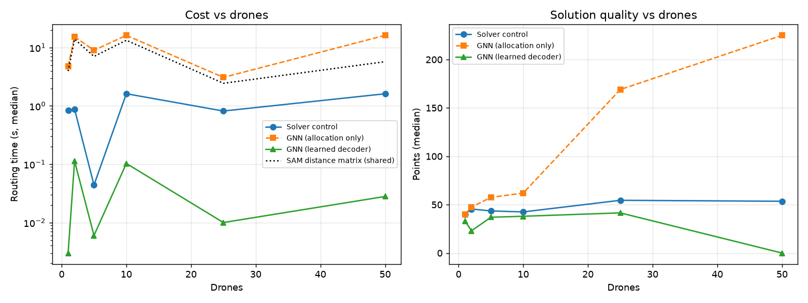
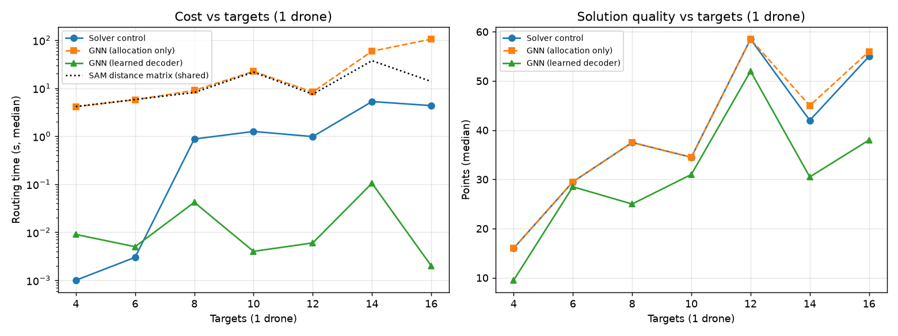

# GNN planner vs. existing planners

Generated by `scripts/gnn_report.py`. The control is the deterministic allocator + exact Held-Karp orienteering solver shipped on `main`.

## Paired comparison — identical environments

Every planner ran the same **100** environments, replayed from a recorded benchmark batch (1 drone, 15 targets, seed 42). The LLM rows are the originally recorded results; the rest were computed by replay.

| Planner | Mean latency | Valid-solution rate | Mean points (valid only) | Mean coverage |
|---|---|---|---|---|
| Reasoning (LLM) | 48.562 s | 34 % | 30.8 | 44 % |
| LangGraph v4 (LLM) | 37.419 s | 36 % | 32.4 | 50 % |
| Solver control | 0.245 s | 97 % | 35.9 | 40 % |
| GNN (allocation only) | 0.705 s | 97 % | 35.9 | 40 % |
| GNN (learned decoder) | 0.141 s | 97 % | 32.5 | 38 % |

### Head-to-head on runs where both produced a *fuel-feasible* solution

| Matchup | Runs compared | Wins | Losses | Ties | Mean point delta |
|---|---|---|---|---|---|
| GNN (allocation only) vs Solver control | 97 | 1 | 0 | 96 | +0.02 |
| GNN (learned decoder) vs Solver control | 97 | 1 | 39 | 57 | -3.39 |
| Solver control vs LangGraph v4 (LLM) | 36 | 0 | 0 | 36 | +0.00 |
| GNN (learned decoder) vs LangGraph v4 (LLM) | 36 | 0 | 3 | 33 | -0.83 |

## Scaling study

`routing` is total time minus the shared SAM-aware distance-matrix build. Both planners pay the matrix cost, so only the routing column reflects work the GNN can actually displace.

### Axis: drones (targets fixed)

| Drones | Matrix (s) | Solver control total / routing (s) | GNN (allocation only) total / routing (s) | GNN (learned decoder) total / routing (s) | Points (control / decoder) |
|---|---|---|---|---|---|
| 1 | 3.95 | 4.80 / 0.84 | 8.77 / 4.82 | 3.96 / 0.00 | 40 / 33 |
| 2 | 13.94 | 14.82 / 0.88 | 29.24 / 15.29 | 14.06 / 0.11 | 46 / 23 |
| 5 | 7.04 | 7.09 / 0.04 | 16.03 / 8.99 | 7.02 / 0.01 | 44 / 37 |
| 10 | 13.35 | 14.96 / 1.62 | 29.55 / 16.21 | 13.45 / 0.10 | 42 / 38 |
| 25 | 2.44 | 3.26 / 0.82 | 5.52 / 3.08 | 2.45 / 0.01 | 54 / 42 |
| 50 | 5.73 | 7.34 / 1.61 | 21.92 / 16.19 | 5.75 / 0.03 | 54 / 0 |

### Axis: targets per drone (1 drone)

| Targets | Matrix (s) | Solver control total / routing (s) | GNN (allocation only) total / routing (s) | GNN (learned decoder) total / routing (s) | Points (control / decoder) |
|---|---|---|---|---|---|
| 4 | 4.15 | 4.14 / 0.00 | 8.28 / 4.13 | 4.16 / 0.01 | 16 / 10 |
| 6 | 5.81 | 5.78 / 0.00 | 11.58 / 5.76 | 5.81 / 0.01 | 30 / 28 |
| 8 | 8.14 | 9.02 / 0.88 | 17.14 / 8.99 | 8.18 / 0.04 | 38 / 25 |
| 10 | 21.60 | 22.86 / 1.26 | 44.01 / 22.41 | 21.59 / 0.00 | 34 / 31 |
| 12 | 7.50 | 8.48 / 0.98 | 15.82 / 8.32 | 7.40 / 0.01 | 58 / 52 |
| 14 | 37.44 | 42.72 / 5.27 | 113.93 / 59.08 | 37.14 / 0.10 | 42 / 30 |
| 16 | 13.82 | 18.17 / 4.34 | 118.91 / 105.08 | 13.78 / 0.00 | 55 / 38 |

### Charts

